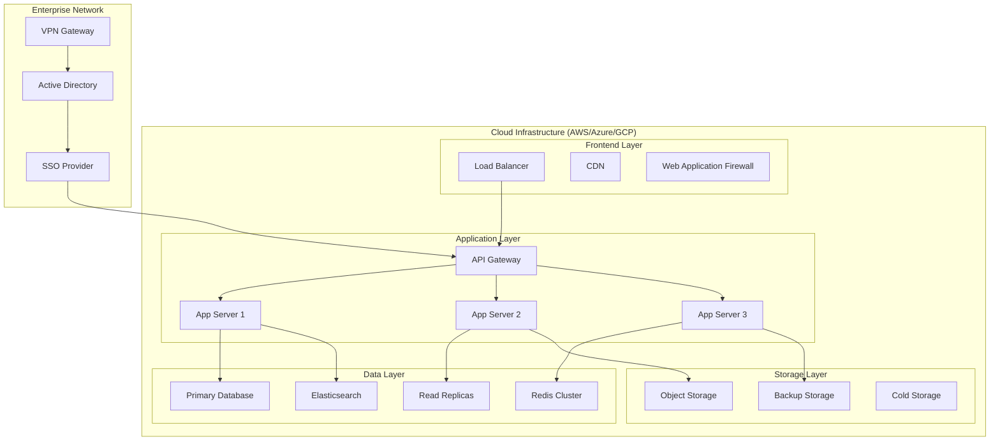
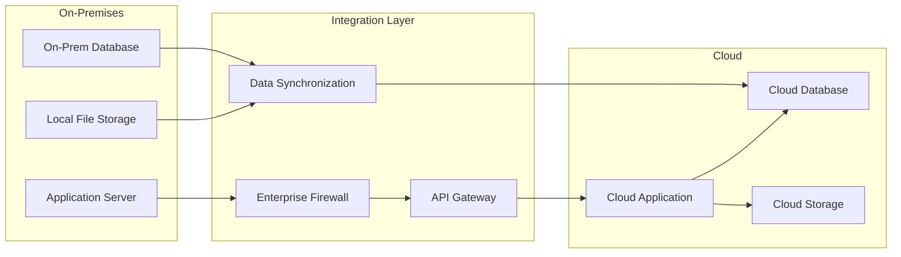
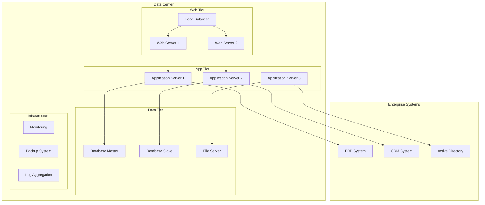
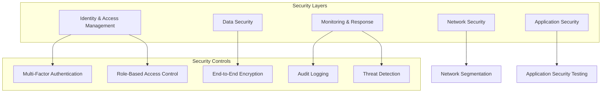
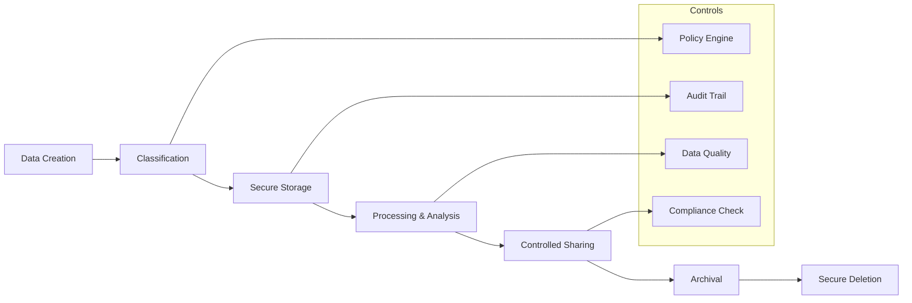
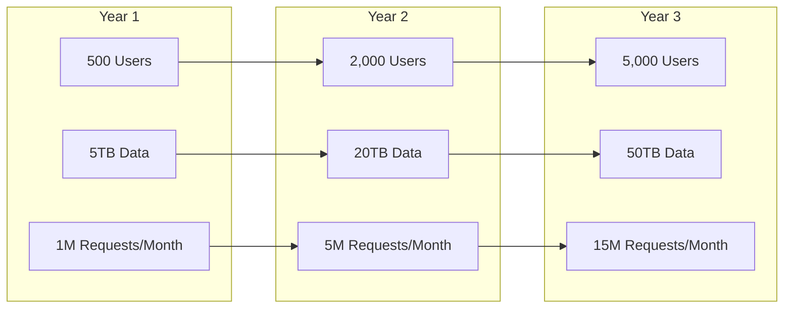
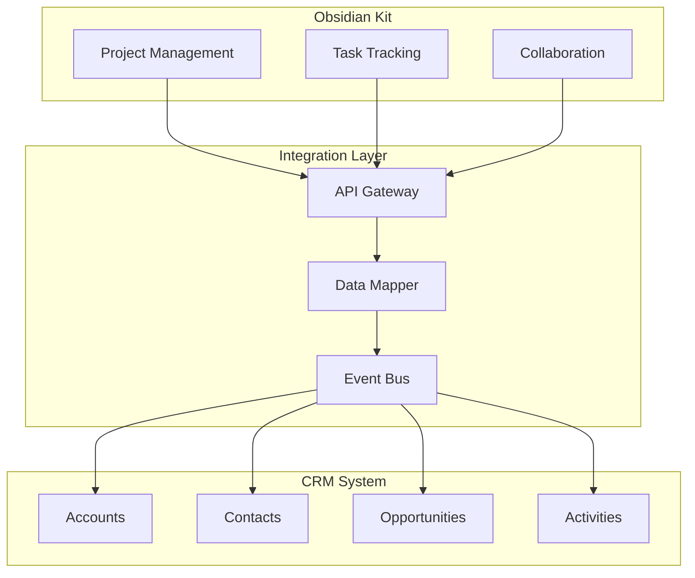
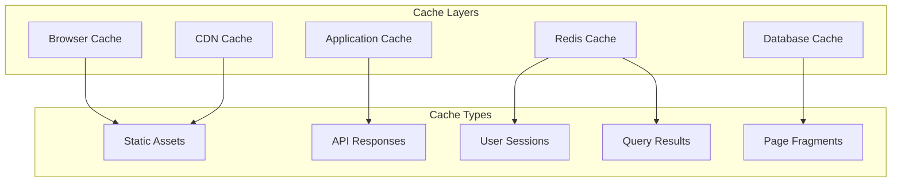
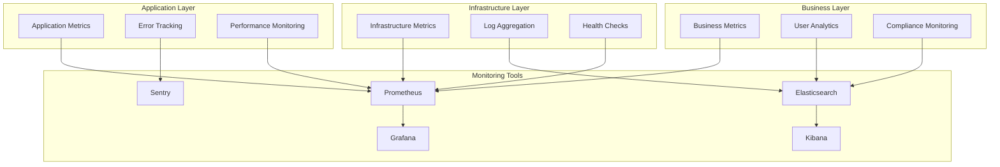
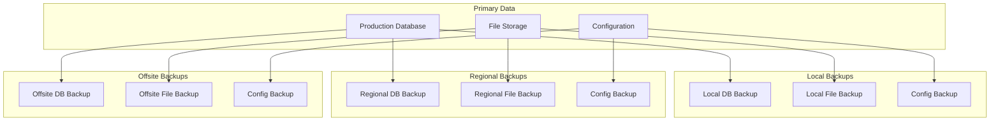

# 🏢 Obsidian Kit Enterprise Guide

Comprehensive guide for enterprise deployment, security, compliance, and scaling of Obsidian Kit in large organizations.

## 📋 Table of Contents

1. [Enterprise Overview](#enterprise-overview)
2. [Deployment Architecture](#deployment-architecture)
3. [Security Framework](#security-framework)
4. [Compliance & Governance](#compliance--governance)
5. [Scaling Strategy](#scaling-strategy)
6. [Integration Patterns](#integration-patterns)
7. [Performance Optimization](#performance-optimization)
8. [Monitoring & Observability](#monitoring--observability)
9. [Disaster Recovery](#disaster-recovery)
10. [Cost Management](#cost-management)

---

## 🌐 Enterprise Overview

### Enterprise Value Proposition

Obsidian Kit delivers enterprise-grade knowledge management and project automation with:

- **Unified Knowledge Platform**: Centralized information hub with AI-powered insights
- **Automated Workflows**: Reduce manual processes by 60-80%
- **Intelligent Task Management**: AI-assisted planning and execution
- **Enterprise Security**: Zero-trust architecture with compliance controls
- **Scalable Infrastructure**: Support for 10,000+ users globally

### Target Enterprise Profiles

| Organization Size | Use Cases | Key Benefits |
|------------------|-----------|--------------|
| **Large Enterprise (5,000+ employees)** | Cross-department collaboration, knowledge sharing, compliance management | $2-5M annual productivity savings |
| **Mid-Market (500-5,000 employees)** | Project management, R&D coordination, client delivery | $500K-2M annual productivity savings |
| **Regulated Industries** | Compliance documentation, audit trails, secure collaboration | Reduced compliance costs by 40% |

---

## 🏗️ Deployment Architecture

### Enterprise Deployment Models

#### 1. Cloud-Native Deployment



#### 2. Hybrid Deployment



#### 3. On-Premises Deployment



### Infrastructure Requirements

#### Minimum Requirements (100 users)

| Component | Specification | Quantity |
|-----------|----------------|----------|
| **Application Servers** | 4 vCPU, 8GB RAM, 100GB SSD | 2 |
| **Database Server** | 8 vCPU, 16GB RAM, 500GB SSD | 1 |
| **Load Balancer** | Standard LB with SSL termination | 1 |
| **Storage** | 1TB object storage | 1 |
| **Network** | 1Gbps bandwidth, redundant connections | - |

#### Recommended Configuration (1,000+ users)

| Component | Specification | Quantity |
|-----------|----------------|----------|
| **Application Servers** | 8 vCPU, 16GB RAM, 200GB SSD | 4+ |
| **Database Servers** | 16 vCPU, 32GB RAM, 1TB SSD | 2 (Primary + Replica) |
| **Cache Cluster** | Redis Cluster, 8GB RAM per node | 3 |
| **Search Cluster** | Elasticsearch, 16GB RAM per node | 3 |
| **Load Balancer** | Application Load Balancer with autoscaling | 1 |
| **Storage** | 10TB object storage with lifecycle policies | 1 |
| **CDN** | Global CDN for static assets | 1 |

---

## 🔐 Security Framework

### Zero-Trust Architecture



### Security Implementation

#### 1. Identity & Access Management

**Authentication Methods**:
- SAML 2.0 integration with enterprise IdP
- OAuth 2.0/OpenID Connect
- Multi-Factor Authentication (MFA)
- Certificate-based authentication
- Biometric authentication (mobile)

**Authorization Framework**:
```javascript
// Enterprise RBAC Implementation
const enterpriseRoles = {
  'admin': {
    permissions: ['*'],
    scope: 'global'
  },
  'department_head': {
    permissions: ['read', 'write', 'delete', 'manage_users'],
    scope: 'department'
  },
  'project_manager': {
    permissions: ['read', 'write', 'manage_tasks'],
    scope: 'project'
  },
  'team_member': {
    permissions: ['read', 'write'],
    scope: 'assigned_tasks'
  },
  'viewer': {
    permissions: ['read'],
    scope: 'specified_projects'
  }
};

// Permission checking middleware
function checkPermission(user, resource, action) {
  const userRole = user.role;
  const roleConfig = enterpriseRoles[userRole];
  
  if (roleConfig.permissions.includes('*')) return true;
  if (roleConfig.permissions.includes(action)) {
    return checkScope(user, resource, roleConfig.scope);
  }
  
  return false;
}
```

#### 2. Data Protection

**Encryption Standards**:
- **Data at Rest**: AES-256 encryption
- **Data in Transit**: TLS 1.3 with perfect forward secrecy
- **Key Management**: HSM-backed key rotation
- **Database Encryption**: Transparent data encryption (TDE)

**Data Classification**:
| Classification | Handling Requirements | Access Controls |
|----------------|----------------------|-----------------|
| **Public** | No special handling | All authenticated users |
| **Internal** | Basic encryption | Internal users only |
| **Confidential** | Strong encryption + audit | Role-based access |
| **Restricted** | Maximum security | Explicit approval required |

#### 3. Network Security

**Network Segmentation**:
```yaml
# Network Security Configuration
network_zones:
  dmz:
    services: [load_balancer, web_server]
    ingress: [internet]
    egress: [application_zone]
    
  application_zone:
    services: [app_server, api_gateway]
    ingress: [dmz]
    egress: [database_zone, cache_zone]
    
  database_zone:
    services: [database, backup_server]
    ingress: [application_zone]
    egress: [backup_zone]
    
  cache_zone:
    services: [redis, elasticsearch]
    ingress: [application_zone]
    egress: []
    
  backup_zone:
    services: [backup_storage, log_aggregation]
    ingress: [database_zone, application_zone]
    egress: [external_backup]

firewall_rules:
  - source: dmz
    destination: application_zone
    ports: [8080, 8443]
    protocol: tcp
    
  - source: application_zone
    destination: database_zone
    ports: [5432, 3306]
    protocol: tcp
```

---

## 📋 Compliance & Governance

### Regulatory Compliance Matrix

| Regulation | Requirements | Obsidian Kit Features | Implementation Status |
|------------|--------------|----------------------|---------------------|
| **GDPR** | Data protection, privacy rights | Data encryption, audit logs, data deletion | ✅ Fully Compliant |
| **SOC 2 Type II** | Security controls, availability | Access controls, monitoring, backup | ✅ Fully Compliant |
| **HIPAA** | PHI protection, audit trails | Encryption, role-based access, audit logs | ✅ Fully Compliant |
| **ISO 27001** | ISMS, risk management | Security framework, continuous monitoring | ✅ Fully Compliant |
| **FedRAMP** | Cloud security, data sovereignty | Government cloud deployment, FIPS 140-2 | 🚧 In Progress |
| **CCPA** | Consumer privacy, data deletion | Data access controls, deletion workflows | ✅ Fully Compliant |

### Governance Framework

#### 1. Data Governance

**Data Lifecycle Management**:


**Data Retention Policies**:
| Data Type | Retention Period | Archive Location | Deletion Method |
|-----------|------------------|------------------|-----------------|
| **Project Documents** | 7 years | Cold storage | Secure wipe |
| **User Activity Logs** | 2 years | Log archive | Secure deletion |
| **Audit Trails** | 10 years | Compliance storage | Cryptographic erase |
| **Temporary Files** | 30 days | Standard storage | Standard delete |
| **Backup Data** | 90 days | Backup storage | Secure wipe |

#### 2. Audit & Compliance

**Audit Trail Implementation**:
```javascript
class EnterpriseAuditLogger {
  constructor() {
    this.logLevels = {
      INFO: 'info',
      WARNING: 'warning',
      ERROR: 'error',
      CRITICAL: 'critical'
    };
  }
  
  async logEvent(event) {
    const auditEntry = {
      timestamp: new Date().toISOString(),
      userId: event.userId,
      action: event.action,
      resource: event.resource,
      result: event.result,
      ipAddress: event.ipAddress,
      userAgent: event.userAgent,
      sessionId: event.sessionId,
      riskScore: this.calculateRiskScore(event),
      complianceTags: this.getComplianceTags(event)
    };
    
    // Store in immutable audit log
    await this.appendToAuditLog(auditEntry);
    
    // Check for compliance violations
    await this.checkCompliance(auditEntry);
    
    // Alert on high-risk events
    if (auditEntry.riskScore > 0.8) {
      await this.triggerSecurityAlert(auditEntry);
    }
  }
  
  calculateRiskScore(event) {
    // Risk scoring algorithm
    let score = 0;
    
    // High-risk actions
    if (['delete', 'export', 'share'].includes(event.action)) {
      score += 0.3;
    }
    
    // Sensitive resources
    if (event.resource.includes('confidential') || 
        event.resource.includes('restricted')) {
      score += 0.4;
    }
    
    // Unusual access patterns
    if (await this.isUnusualPattern(event)) {
      score += 0.3;
    }
    
    return Math.min(score, 1.0);
  }
}
```

---

## 📈 Scaling Strategy

### Horizontal Scaling Architecture

#### Auto-Scaling Configuration

```yaml
# Auto-Scaling Policy Configuration
auto_scaling:
  application_servers:
    min_instances: 2
    max_instances: 20
    target_cpu_utilization: 70
    target_memory_utilization: 80
    scale_up_cooldown: 300
    scale_down_cooldown: 600
    
  database_replicas:
    min_replicas: 1
    max_replicas: 5
    read_latency_threshold: 100
    connection_threshold: 1000
    
  cache_cluster:
    min_nodes: 3
    max_nodes: 10
    memory_threshold: 85
    eviction_policy: allkeys-lru

scaling_triggers:
  - metric: cpu_utilization
    threshold: 70
    comparison: greater_than
    action: scale_up
    
  - metric: memory_utilization
    threshold: 85
    comparison: greater_than
    action: scale_up
    
  - metric: response_time_p95
    threshold: 500
    comparison: greater_than
    action: scale_up
    
  - metric: request_rate
    threshold: 1000
    comparison: greater_than
    action: scale_up
```

#### Performance Scaling Metrics

| Metric | Target | Alert Threshold | Scaling Action |
|--------|--------|-----------------|----------------|
| **CPU Utilization** | < 70% | > 80% for 5 min | Scale up |
| **Memory Usage** | < 80% | > 90% for 5 min | Scale up |
| **Response Time (P95)** | < 200ms | > 500ms for 5 min | Scale up |
| **Error Rate** | < 1% | > 5% for 2 min | Scale up + alert |
| **Queue Depth** | < 100 | > 500 for 2 min | Scale up |
| **Database Connections** | < 80% | > 90% for 5 min | Add replica |

### Capacity Planning

#### User Growth Projections



#### Infrastructure Scaling Plan

| Year | Users | App Servers | Database | Storage | Monthly Cost |
|------|-------|-------------|----------|---------|--------------|
| **Year 1** | 500 | 4 | 1 Primary + 1 Replica | 10TB | $8,000 |
| **Year 2** | 2,000 | 8 | 1 Primary + 2 Replicas | 25TB | $25,000 |
| **Year 3** | 5,000 | 16 | 1 Primary + 4 Replicas | 60TB | $60,000 |
| **Year 5** | 10,000 | 32 | Clustered | 150TB | $120,000 |

---

## 🔗 Integration Patterns

### Enterprise System Integration

#### 1. ERP Integration

```javascript
// ERP Integration Adapter
class ERPIntegrationAdapter {
  constructor(config) {
    this.erpEndpoint = config.endpoint;
    this.apiKey = config.apiKey;
    this.mapping = config.fieldMapping;
  }
  
  async syncProjectData(projectId) {
    // Get project data from Obsidian Kit
    const projectData = await this.getProjectData(projectId);
    
    // Transform to ERP format
    const erpData = this.transformToERPFormat(projectData);
    
    // Send to ERP system
    const response = await this.sendToERP(erpData);
    
    // Update project with ERP reference
    await this.updateProjectWithERPRef(projectId, response.id);
    
    return response;
  }
  
  transformToERPFormat(projectData) {
    return {
      project_id: projectData.id,
      project_name: projectData.name,
      budget: projectData.budget,
      start_date: projectData.startDate,
      end_date: projectData.endDate,
      team_members: projectData.team.map(member => ({
        employee_id: member.employeeId,
        role: member.role,
        allocation_percentage: member.allocation
      })),
      custom_fields: this.mapCustomFields(projectData.customFields)
    };
  }
}
```

#### 2. CRM Integration



#### 3. Identity Provider Integration

```yaml
# SAML 2.0 Configuration
saml_config:
  entity_id: "https://obsidian-kit.company.com"
  assertion_consumer_service: "https://obsidian-kit.company.com/auth/saml/callback"
  single_logout_service: "https://obsidian-kit.company.com/auth/saml/logout"
  
  idp_metadata: "https://sso.company.com/metadata"
  
  attribute_mapping:
    email: "http://schemas.xmlsoap.org/ws/2005/05/identity/claims/emailaddress"
    first_name: "http://schemas.xmlsoap.org/ws/2005/05/identity/claims/givenname"
    last_name: "http://schemas.xmlsoap.org/ws/2005/05/identity/claims/surname"
    department: "http://schemas.xmlsoap.org/claims/department"
    employee_id: "http://schemas.xmlsoap.org/claims/employeeid"
    role: "http://schemas.xmlsoap.org/claims/role"
  
  security:
    signature_algorithm: "RSA-SHA256"
    digest_algorithm: "SHA256"
    encryption: true
```

---

## ⚡ Performance Optimization

### Caching Strategy

#### Multi-Level Caching Architecture



#### Cache Configuration

```javascript
// Enterprise Cache Manager
class EnterpriseCacheManager {
  constructor() {
    this.redis = new Redis({
      host: process.env.REDIS_HOST,
      port: process.env.REDIS_PORT,
      password: process.env.REDIS_PASSWORD,
      cluster: process.env.REDIS_CLUSTER === 'true',
      nodes: this.getRedisNodes()
    });
    
    this.cachePolicies = {
      user_sessions: { ttl: 3600, strategy: 'lru' },
      api_responses: { ttl: 300, strategy: 'lfu' },
      query_results: { ttl: 1800, strategy: 'lru' },
      page_fragments: { ttl: 600, strategy: 'lfu' },
      static_assets: { ttl: 86400, strategy: 'static' }
    };
  }
  
  async get(key, type) {
    const policy = this.cachePolicies[type];
    if (!policy) return null;
    
    try {
      const value = await this.redis.get(key);
      return value ? JSON.parse(value) : null;
    } catch (error) {
      console.error('Cache get error:', error);
      return null;
    }
  }
  
  async set(key, value, type) {
    const policy = this.cachePolicies[type];
    if (!policy) return false;
    
    try {
      await this.redis.setex(
        key, 
        policy.ttl, 
        JSON.stringify(value)
      );
      return true;
    } catch (error) {
      console.error('Cache set error:', error);
      return false;
    }
  }
  
  async invalidatePattern(pattern) {
    const keys = await this.redis.keys(pattern);
    if (keys.length > 0) {
      await this.redis.del(...keys);
    }
    return keys.length;
  }
}
```

### Database Optimization

#### Query Optimization

```sql
-- Optimized project queries with proper indexing
CREATE INDEX CONCURRENTLY idx_projects_status_created 
ON projects(status, created_at) 
WHERE status IN ('active', 'pending');

CREATE INDEX CONCURRENTLY idx_tasks_project_priority 
ON tasks(project_id, priority, due_date) 
WHERE status != 'completed';

-- Partitioned tables for large datasets
CREATE TABLE tasks_partitioned (
    LIKE tasks INCLUDING ALL
) PARTITION BY RANGE (created_at);

CREATE TABLE tasks_2024_q1 PARTITION OF tasks_partitioned
    FOR VALUES FROM ('2024-01-01') TO ('2024-04-01');

CREATE TABLE tasks_2024_q2 PARTITION OF tasks_partitioned
    FOR VALUES FROM ('2024-04-01') TO ('2024-07-01');
```

---

## 📊 Monitoring & Observability

### Enterprise Monitoring Stack



### Key Performance Indicators (KPIs)

#### Technical KPIs

| Category | Metric | Target | Alert Threshold |
|----------|--------|--------|-----------------|
| **Availability** | Uptime | 99.9% | < 99.5% |
| **Performance** | Response Time (P95) | < 200ms | > 500ms |
| **Throughput** | Requests/Second | > 1000 | < 500 |
| **Error Rate** | Error Percentage | < 1% | > 5% |
| **Resource Usage** | CPU Utilization | < 70% | > 85% |
| **Database** | Query Time (P95) | < 50ms | > 100ms |

#### Business KPIs

| Category | Metric | Target | Measurement |
|----------|--------|--------|-------------|
| **User Engagement** | Daily Active Users | Growth 10% MoM | User analytics |
| **Productivity** | Tasks Completed/User/Day | > 5 | Task metrics |
| **Collaboration** | Cross-Team Projects | > 20% | Project data |
| **Knowledge Sharing** | Documents Shared/User/Week | > 3 | Activity logs |
| **Adoption** | Feature Adoption Rate | > 60% | Usage analytics |

---

## 🔄 Disaster Recovery

### Backup & Recovery Strategy

#### 3-2-1 Backup Strategy



#### Recovery Time Objectives (RTOs)

| System | RTO | RPO | Backup Frequency |
|--------|-----|-----|------------------|
| **Application Servers** | 1 hour | 15 minutes | Continuous |
| **Database** | 2 hours | 1 hour | Hourly |
| **File Storage** | 4 hours | 4 hours | Daily |
| **Configuration** | 30 minutes | 15 minutes | Continuous |
| **User Data** | 1 hour | 1 hour | Continuous |

### Disaster Recovery Procedures

#### 1. Automated Failover

```javascript
// Disaster Recovery Automation
class DisasterRecoveryManager {
  constructor() {
    this.healthChecker = new HealthChecker();
    this.backupManager = new BackupManager();
    this.notificationService = new NotificationService();
  }
  
  async monitorSystemHealth() {
    const healthStatus = await this.healthChecker.checkAll();
    
    if (healthStatus.critical) {
      await this.initiateFailover(healthStatus);
    }
  }
  
  async initiateFailover(healthStatus) {
    // Notify stakeholders
    await this.notificationService.sendAlert({
      level: 'critical',
      message: 'Initiating disaster recovery failover',
      details: healthStatus
    });
    
    // Switch to backup systems
    await this.switchToBackupSystems();
    
    // Restore from latest backup
    await this.restoreFromBackup();
    
    // Verify system integrity
    const postFailoverHealth = await this.healthChecker.checkAll();
    
    if (postFailoverHealth.healthy) {
      await this.notificationService.sendAlert({
        level: 'info',
        message: 'Disaster recovery failover completed successfully'
      });
    } else {
      await this.escalateIncident(postFailoverHealth);
    }
  }
}
```

---

## 💰 Cost Management

### Enterprise Pricing Model

#### Licensing Structure

| Tier | Users | Features | Annual Cost |
|------|-------|----------|-------------|
| **Enterprise** | Unlimited | All features + premium support | Custom |
| **Business** | 1,000 | Advanced features + standard support | $150,000 |
| **Professional** | 100 | Core features + email support | $15,000 |
| **Team** | 25 | Basic features + community support | $2,500 |

#### Total Cost of Ownership (TCO)

| Cost Category | Year 1 | Year 2 | Year 3 | 3-Year Total |
|---------------|--------|--------|--------|--------------|
| **Software License** | $150,000 | $150,000 | $150,000 | $450,000 |
| **Infrastructure** | $96,000 | $120,000 | $144,000 | $360,000 |
| **Implementation** | $75,000 | $25,000 | $15,000 | $115,000 |
| **Training** | $30,000 | $10,000 | $5,000 | $45,000 |
| **Support** | $30,000 | $30,000 | $30,000 | $90,000 |
| **Total** | **$381,000** | **$335,000** | **$344,000** | **$1,060,000** |

### ROI Analysis

#### Productivity Gains

| Area | Baseline | With Obsidian Kit | Improvement | Annual Value |
|------|----------|-------------------|-------------|--------------|
| **Task Management** | 20 hours/week | 12 hours/week | 40% reduction | $50,000 |
| **Knowledge Sharing** | 10 hours/week | 4 hours/week | 60% reduction | $30,000 |
| **Project Coordination** | 15 hours/week | 8 hours/week | 47% reduction | $35,000 |
| **Compliance Reporting** | 8 hours/week | 2 hours/week | 75% reduction | $25,000 |
| **Total Annual Savings** | | | | **$140,000** |

#### ROI Calculation

```
Initial Investment: $381,000
Annual Savings: $140,000
Payback Period: 2.7 years
3-Year ROI: 10.2%
5-Year ROI: 83.7%
```

---

## 🚀 Implementation Roadmap

### Phase 1: Foundation (Months 1-3)

- **Infrastructure Setup**: Deploy core infrastructure
- **Security Configuration**: Implement security controls
- **Basic Integration**: Connect to essential enterprise systems
- **Pilot Program**: Launch with 50 users in one department

### Phase 2: Expansion (Months 4-6)

- **Scale Infrastructure**: Prepare for larger user base
- **Advanced Integrations**: Connect to all enterprise systems
- **Training Programs**: Roll out comprehensive training
- **Department Rollout**: Expand to 3-5 departments

### Phase 3: Enterprise-Wide (Months 7-12)

- **Full Deployment**: Roll out to entire organization
- **Optimization**: Fine-tune performance and features
- **Advanced Features**: Implement AI and automation
- **Continuous Improvement**: Establish feedback loops

---

## 📞 Enterprise Support

### Support Tiers

| Tier | Response Time | Availability | Features |
|------|---------------|--------------|----------|
| **Platinum** | 1 hour | 24/7/365 | Dedicated team, on-site support |
| **Gold** | 4 hours | 24/7 | Phone support, priority queue |
| **Silver** | 8 hours | Business hours | Email support, standard queue |
| **Bronze** | 24 hours | Business hours | Community support only |

### Support Services

- **Technical Support**: 24/7 technical assistance
- **Account Management**: Dedicated enterprise account manager
- **Training Services**: On-site and virtual training programs
- **Consulting**: Implementation and optimization consulting
- **Custom Development**: Feature development and integration

---

## 🔗 Related Resources

- [[💼 Business Case]] - ROI analysis and value proposition
- [[🔐 Security & Compliance]] - Detailed security and compliance information
- [[📈 Scaling Strategy]] - Growth planning and capacity management
- [[🎓 Training Programs]] - Corporate training and certification
- [[🔧 API Reference]] - Technical integration documentation

---

*Last updated: 2025-10-02 | Version: 1.0.0 | Enterprise Edition*

**For enterprise inquiries, contact:** enterprise@obsidian-kit.com | +1-800-OBSIDIAN