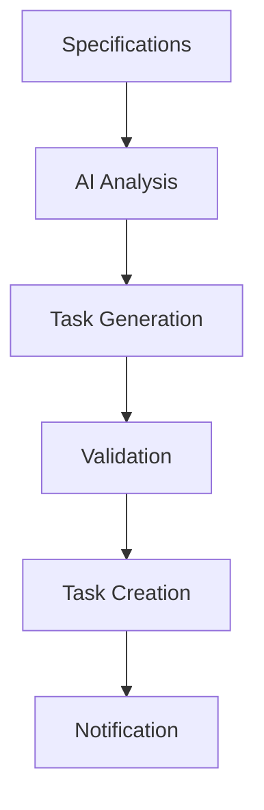
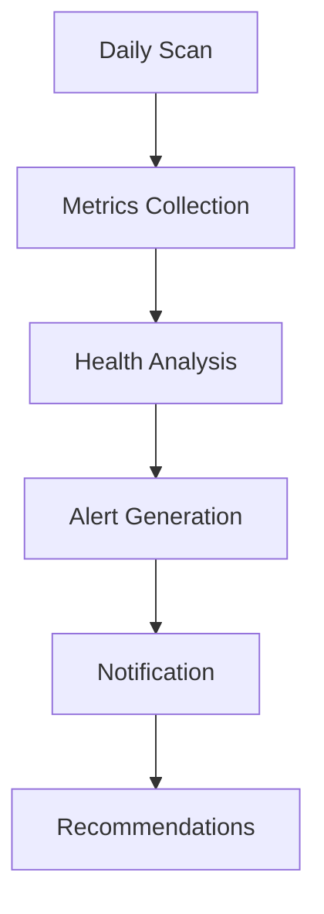
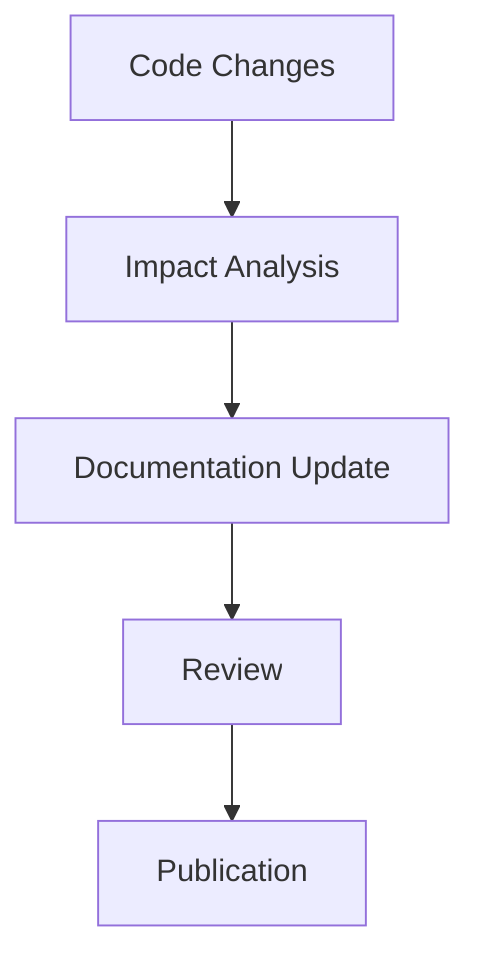

# 👤 Obsidian Kit User Guide

The comprehensive user manual for mastering Obsidian Kit's AI-powered project management system.

## 📋 Table of Contents

1. [Introduction](#introduction)
2. [Core Concepts](#core-concepts)
3. [Vault Structure](#vault-structure)
4. [Task Management](#task-management)
5. [AI Agent Integration](#ai-agent-integration)
6. [Workflows](#workflows)
7. [Advanced Features](#advanced-features)
8. [Best Practices](#best-practices)
9. [Troubleshooting](#troubleshooting)

---

## 🎯 Introduction

### What is Obsidian Kit?

Obsidian Kit is a comprehensive AI-powered project management system built on Obsidian. It combines:

- **Knowledge Management**: Obsidian's powerful linking and graph capabilities
- **AI Integration**: Multiple AI agents for intelligent assistance
- **Task Management**: Advanced task tracking with Dataview
- **Workflow Automation**: Spec-driven development processes
- **Health Monitoring**: Real-time project health tracking

### Who is this for?

- **Project Managers**: Track complex projects with AI assistance
- **Developers**: Manage code projects with intelligent task breakdown
- **Researchers**: Organize research with semantic search
- **Teams**: Collaborate with shared context and workflows
- **Individuals**: Personal productivity with AI-powered insights

### Key Benefits

- 🚀 **Faster Project Setup**: Initialize complete project structures in seconds
- 🤖 **AI-Powered Insights**: Get intelligent assistance throughout your workflow
- 📊 **Real-time Visibility**: Track progress and health across all projects
- 🔄 **Automated Workflows**: Reduce manual work with intelligent automation
- 🧠 **Knowledge Graph**: Discover connections and insights automatically

---

## 🧠 Core Concepts

### The 4-Folder Structure

Every Obsidian Kit vault follows a standardized structure:

```
project-vault/
├── 1 - Source Materials/     # External knowledge and references
├── 2 - Daily Notes/          # Daily progress and planning
├── 3 - Templates/            # Reusable templates
└── 4 - Projects/             # Active work and tasks
```

#### 1 - Source Materials/
Your external knowledge base:
- **Books/**: Reading notes and book summaries
- **Documentation/**: Technical documentation and references
- **Research/**: Research papers and articles
- **Resources/**: Links, tools, and external resources

#### 2 - Daily Notes/
Daily planning and reflection:
- **Task Overview/**: Daily task summaries
- **Journal/**: Personal reflections and insights
- **Meeting Notes/**: Meeting summaries and action items

#### 3 - Templates/
Reusable templates for consistency:
- **Project Management/**: Project templates and structures
- **Tasks/**: Task templates with standard frontmatter
- **Meetings/**: Meeting note templates
- **Reviews/**: Review and retrospective templates

#### 4 - Projects/
Active work and deliverables:
- **Tasks.base**: Central task database
- **Project Management Dashboard.md**: Real-time overview
- **Active Projects/**: Current project folders
- **Archived/**: Completed projects

### Spec-Driven Development

The `.specify/` directory contains your project specifications:

```
.specify/
├── memory/           # Project constitution and decisions
├── specs/            # Requirements and architecture
└── workflows/        # Development processes
```

#### Constitution (`memory/constitution.md`)
Your project's guiding principles:
- Mission and vision
- Core values and principles
- Decision-making framework
- Team agreements

#### Specifications (`specs/`)
Living technical documents:
- **requirements.md**: Functional and non-functional requirements
- **architecture.md**: System architecture and design
- **api.md**: API specifications
- **database.md**: Database schema and design

#### Workflows (`workflows/`)
Standardized processes:
- **development.md**: Development workflow
- **review.md**: Code review process
- **deployment.md**: Deployment procedures
- **testing.md**: Testing strategies

### AI Agent System

Multiple AI agents work together through standardized configurations:

#### Universal Context
Shared knowledge for all agents:
- Project overview and goals
- Team structure and roles
- Development standards
- Current priorities and blockers

#### Agent-Specific Configurations
Each AI tool has tailored settings:
- **Claude Code**: Advanced reasoning and documentation
- **OpenCode**: VS Code integration and real-time assistance
- **Cursor**: AI-assisted coding and debugging
- **Copilot**: GitHub integration and code suggestions

#### Slash Commands
Standardized commands across all agents:
- `/status`: Check project status
- `/tasks`: Show current tasks
- `/help`: Get assistance
- `/research`: Research specific topics
- `/plan`: Create project plans

---

## 🏗️ Vault Structure

### Navigating Your Vault

#### Home Base: Project Management Dashboard

The `4 - Projects/Project Management Dashboard.md` is your command center:

```dataview
TABLE 
  status as "Status",
  priority as "Priority", 
  due_date as "Due Date",
  assignee as "Owner"
FROM "4 - Projects"
WHERE status != "completed"
SORT priority DESC, due_date ASC
```

#### Central Task Database: Tasks.base

The `4 - Projects/Tasks.base` file contains:
- All task definitions with standardized frontmatter
- Dataview queries for different views
- Kanban boards for visual management
- Progress tracking and metrics

#### Agent Configuration Hub

The `agents/` directory contains:
- `universal-context.md`: Shared project knowledge
- `claude-code.md`: Claude-specific settings
- `opencode.md`: VS Code integration
- `cursor.md`: Cursor AI configuration
- `slash-commands.md`: Standardized commands

### File Organization Best Practices

#### Naming Conventions
- **Projects**: `Project-Name/` (PascalCase)
- **Tasks**: `task-name.md` (kebab-case)
- **Daily Notes**: `YYYY-MM-DD.md` (ISO date)
- **Templates**: `template-type.md` (descriptive)

#### Linking Strategy
- Use **wiki links** for internal connections: `[[Task Name]]`
- Use **markdown links** for external resources: `[Text](url)`
- Create **link clouds** for related concepts
- Maintain **backlinks** for traceability

#### Tag System
Standardized tags for organization:
- `#project`: Project-related content
- `#task`: Task definitions and updates
- `#meeting`: Meeting notes and summaries
- `#decision`: Important decisions
- `#resource`: External resources and references
- `#ai-generated`: Content created by AI agents

---

## 📋 Task Management

### Task Lifecycle

#### 1. Task Creation
Tasks can be created through:
- **Manual Creation**: Using task templates
- **AI Generation**: From specifications and requirements
- **Automated**: From code changes and user stories
- **Breakdown**: Decomposing complex tasks

#### 2. Task Structure
Each task follows this template:

```yaml
---
title: "Implement User Authentication"
status: "todo"  # todo, in-progress, review, completed
priority: "high"  # low, medium, high, critical
project: "Web Application"
assignee: "John Doe"
due_date: "2025-10-15"
created_date: "2025-10-02"
completed_date: ""
time_estimate: 14400  # in seconds (4 hours)
time_spent: 0
dependencies: ["Setup Database", "Design User Model"]
subtasks: ["Create Auth Service", "Implement Login", "Add Registration"]
tags: ["feature", "authentication", "backend"]
acceptance_criteria:
  - Users can register with email and password
  - Users can login with valid credentials
  - Passwords are securely hashed
  - Session management works correctly
---
```

#### 3. Task States

| State | Description | When to Use |
|-------|-------------|-------------|
| `todo` | Not started | New tasks, ready to work |
| `in-progress` | Currently being worked on | Active development |
| `review` | Ready for review | Completed, needs validation |
| `completed` | Finished and validated | Done and verified |

#### 4. Task Priorities

| Priority | Description | Response Time |
|----------|-------------|---------------|
| `critical` | Blocks other work | Immediate |
| `high` | Important for timeline | Within 24 hours |
| `medium` | Normal priority | Within 3 days |
| `low` | Nice to have | Within 1 week |

### Task Management Features

#### Automated Task Generation

```bash
# Generate tasks from specifications
obsidian-kit generate-tasks

# Generate from specific sources
obsidian-kit generate-tasks --source specification
obsidian-kit generate-tasks --source code-changes
obsidian-kit generate-tasks --source user-stories
```

#### AI-Powered Task Breakdown

```bash
# Break down complex task
obsidian-kit breakdown "Build e-commerce platform" --subtasks 8

# Interactive breakdown
obsidian-kit breakdown "Implement payment system" --interactive
```

#### Task Validation

```bash
# Validate single task
obsidian-kit validate "tasks/implement-auth.md"

# Validate all tasks
obsidian-kit validate --all

# Validation checks:
# - Frontmatter completeness
# - Acceptance criteria clarity
# - Time estimate reasonableness
# - Dependency consistency
```

### Dataview Queries

#### Active Tasks View
```dataview
TABLE 
  status as "Status",
  priority as "Priority",
  due_date as "Due Date",
  assignee as "Owner"
FROM "4 - Projects"
WHERE status != "completed"
SORT priority DESC, due_date ASC
```

#### My Tasks View
```dataview
LIST
FROM "4 - Projects"
WHERE contains(assignee, "Your Name")
AND status != "completed"
SORT due_date ASC
```

#### Overdue Tasks View
```dataview
TABLE 
  priority as "Priority",
  due_date as "Due Date",
  "(date(today) - due_date) as 'Days Overdue'"
FROM "4 - Projects"
WHERE status != "completed"
AND due_date < date(today)
SORT due_date ASC
```

#### Project Progress View
```dataview
TABLE 
  (length(filter(rows, (r) => r.status = "completed")) / length(rows)) * 100 as "% Complete",
  length(filter(rows, (r) => r.status = "in-progress")) as "In Progress",
  length(filter(rows, (r) => r.status = "todo")) as "To Do"
FROM "4 - Projects"
GROUP BY project
```

---

## 🤖 AI Agent Integration

### Supported AI Tools

#### Claude Code
**Best for**: Complex reasoning, documentation, architecture

**Features**:
- Advanced context understanding
- Long-form content generation
- Complex problem-solving
- Technical documentation

**Setup**:
```bash
obsidian-kit agent add claude-code
```

#### OpenCode
**Best for**: VS Code integration, real-time assistance

**Features**:
- Real-time code suggestions
- Inline documentation
- Debugging assistance
- Code completion

**Setup**:
```bash
obsidian-kit agent add opencode
```

#### Cursor
**Best for**: AI-assisted coding, debugging

**Features**:
- AI-powered code generation
- Error detection and fixing
- Code refactoring
- Test generation

**Setup**:
```bash
obsidian-kit agent add cursor
```

#### GitHub Copilot
**Best for**: GitHub integration, code suggestions

**Features**:
- Context-aware suggestions
- Pull request assistance
- Code review automation
- Documentation generation

**Setup**:
```bash
obsidian-kit agent add copilot
```

### Agent Configuration

#### Universal Context
The `agents/universal-context.md` file provides shared information:

```markdown
# Universal Context

## Project Overview
- **Name**: Your Project Name
- **Description**: Brief project description
- **Goals**: Main project objectives
- **Timeline**: Project timeline and milestones

## Team Structure
- **Roles**: Team member roles and responsibilities
- **Communication**: Communication channels and protocols
- **Meetings**: Regular meeting schedule

## Development Standards
- **Code Style**: Coding standards and conventions
- **Review Process**: Code review procedures
- **Testing**: Testing requirements and strategies
- **Deployment**: Deployment procedures

## Current Priorities
- **Active Projects**: Currently active projects
- **Deadlines**: Upcoming deadlines
- **Blockers**: Current blockers and issues
```

#### Agent-Specific Settings
Each agent has tailored configuration:

**Claude Code** (`agents/claude-code.md`):
```markdown
# Claude Code Agent Configuration

## Model Settings
- Model: claude-3-sonnet
- Temperature: 0.7
- Max tokens: 4000

## Capabilities
- Complex reasoning and analysis
- Long-form content generation
- Technical documentation
- Architecture design

## Specialization
- System architecture
- Technical writing
- Problem decomposition
- Strategic planning
```

### Using AI Agents

#### Slash Commands
Standardized commands work across all agents:

```bash
# Check project status
/status

# Show current tasks
/tasks

# Get help and guidance
/help

# Research specific topics
/research "microservices architecture"

# Create project plans
/plan "implement user authentication"
```

#### Context-Aware Assistance
Agents have access to:
- Project specifications and requirements
- Current task list and priorities
- Team structure and roles
- Development standards and practices
- Historical decisions and context

#### Best Practices for AI Interaction

1. **Provide Clear Context**: Include relevant background information
2. **Use Specific Commands**: Leverage slash commands for consistency
3. **Review and Refine**: Always review AI-generated content
4. **Iterate**: Provide feedback to improve AI responses
5. **Maintain Context**: Keep universal context updated

---

## 🔄 Workflows

### Spec-Driven Development

#### Phase 1: Constitution
Create project foundation:

```bash
obsidian-kit workflow constitution
```

**Outputs**:
- `.specify/memory/constitution.md` - Project principles
- `.specify/memory/decisions.md` - Decision framework

**Activities**:
- Define project mission and vision
- Establish core values and principles
- Create decision-making framework
- Set team agreements

#### Phase 2: Planning
Define requirements and architecture:

```bash
obsidian-kit workflow planning --interactive
```

**Outputs**:
- `.specify/specs/requirements.md` - Project requirements
- `.specify/specs/architecture.md` - System architecture

**Activities**:
- Gather functional requirements
- Define non-functional requirements
- Design system architecture
- Plan development milestones

#### Phase 3: Development
Implement features and functionality:

```bash
obsidian-kit workflow development
```

**Activities**:
- Generate tasks from specifications
- Break down complex features
- Implement and test features
- Review and validate work

#### Phase 4: Documentation
Create and maintain documentation:

```bash
obsidian-kit workflow documentation
```

**Activities**:
- Generate API documentation
- Update user guides
- Create technical documentation
- Maintain project knowledge base

### Daily Workflow

#### Morning Routine
1. **Status Check**: `obsidian-kit status`
2. **Daily Planning**: Review today's tasks
3. **Context Update**: Update universal context if needed
4. **Team Sync**: Share progress and blockers

#### Work Session
1. **Task Selection**: Choose next task from priority list
2. **AI Assistance**: Use agents for research and problem-solving
3. **Progress Tracking**: Update task status and time spent
4. **Documentation**: Document decisions and insights

#### Evening Routine
1. **Progress Review**: Review completed work
2. **Task Updates**: Update task statuses
3. **Planning**: Plan tomorrow's work
4. **Reflection**: Document insights and learnings

### Automated Workflows

#### Task Generation Workflow


#### Health Monitoring Workflow


#### Documentation Update Workflow


---

## 🚀 Advanced Features

### Knowledge Graph System

#### Semantic Relationships
Automatically discover connections between:
- Tasks and requirements
- Code and documentation
- Decisions and outcomes
- Team members and expertise

#### Knowledge Extraction
AI-powered extraction of:
- Key concepts and entities
- Relationships and dependencies
- Insights and patterns
- Recommendations and suggestions

#### Visual Analytics
Interactive visualizations for:
- Project progress and health
- Team collaboration patterns
- Knowledge distribution
- Risk and opportunity assessment

### Semantic Search

#### Intelligent Content Discovery
Search beyond keyword matching:
- Concept-based search
- Contextual understanding
- Semantic similarity
- Cross-reference discovery

#### Search Capabilities
- **Natural Language**: Search using plain English
- **Concept Search**: Find related concepts and ideas
- **Pattern Matching**: Discover similar patterns and solutions
- **Cross-Reference**: Find connected information

#### Search Examples
```bash
# Find tasks related to authentication
/search "tasks about user authentication"

# Find documentation for APIs
/search "API documentation endpoints"

# Find similar problems
/search "issues like database connection timeout"
```

### Learning Capture System

#### Continuous Learning
Automatically capture and organize:
- Insights from completed tasks
- Lessons learned from failures
- Best practices and patterns
- Team knowledge and expertise

#### Knowledge Categories
- **Technical Insights**: Code patterns, architectures, solutions
- **Process Improvements**: Workflow optimizations, best practices
- **Team Learning**: Collaboration patterns, communication insights
- **Project Knowledge**: Domain-specific knowledge and expertise

#### Learning Analytics
Track and analyze:
- Learning velocity and trends
- Knowledge gaps and opportunities
- Expertise distribution
- Collaboration patterns

### Health Monitoring

#### Real-time Metrics
Track project health across dimensions:
- **Task Completion**: Completion rates and trends
- **Team Workload**: Work distribution and balance
- **Documentation**: Freshness and completeness
- **Integration**: System connectivity and performance

#### Health Scores
Calculate overall health based on:
- Task completion velocity
- Code quality metrics
- Documentation coverage
- Team satisfaction

#### Alerts and Notifications
Proactive alerts for:
- Overdue tasks and milestones
- Resource bottlenecks
- Quality issues
- Integration problems

---

## 💡 Best Practices

### Project Organization

#### Consistent Structure
- Follow the 4-folder structure consistently
- Use standardized naming conventions
- Maintain proper file organization
- Keep templates up to date

#### Link Everything
- Create comprehensive link networks
- Use descriptive link text
- Maintain backlinks for traceability
- Leverage graph view for insights

#### Tag Strategy
- Use consistent tag naming
- Limit tag proliferation
- Create tag hierarchies
- Review and clean up tags regularly

### Task Management

#### Task Definition
- Write clear, specific task titles
- Define acceptance criteria
- Estimate time realistically
- Set appropriate priorities

#### Task Breakdown
- Break large tasks into smaller pieces
- Keep tasks under 4 hours
- Define clear dependencies
- Consider team capacity

#### Progress Tracking
- Update status daily
- Track time spent
- Document blockers
- Celebrate completed work

### AI Agent Usage

#### Context Management
- Keep universal context current
- Provide relevant background
- Use consistent terminology
- Update project information regularly

#### Effective Prompting
- Be specific and clear
- Provide examples when helpful
- Use appropriate commands
- Iterate and refine

#### Quality Assurance
- Review AI-generated content
- Validate suggestions
- Provide feedback
- Maintain human oversight

### Team Collaboration

#### Communication
- Establish clear communication channels
- Define response time expectations
- Use standardized formats
- Document decisions

#### Knowledge Sharing
- Share insights and learnings
- Document processes and procedures
- Create accessible knowledge base
- Encourage peer learning

#### Continuous Improvement
- Regular retrospectives
- Process optimization
- Tool and workflow improvements
- Skill development

---

## 🔧 Troubleshooting

### Common Issues

#### Task Management Problems

**Tasks not showing in Dataview**
1. Check Tasks.base exists in `4 - Projects/`
2. Verify task frontmatter format
3. Ensure Dataview plugin is enabled
4. Refresh Dataview queries
5. Check for syntax errors in queries

**Task validation failures**
1. Review validation error messages
2. Check frontmatter completeness
3. Verify acceptance criteria
4. Validate time estimates
5. Check dependency consistency

#### AI Agent Issues

**Agent not responding**
1. Check agent configuration files
2. Verify MCP server is running
3. Restart Claude Desktop
4. Check API key validity
5. Review universal context

**Poor AI responses**
1. Update universal context
2. Provide more specific prompts
3. Use appropriate slash commands
4. Check for conflicting information
5. Refine agent configuration

#### System Performance

**Slow vault performance**
1. Check vault size and file count
2. Optimize Dataview queries
3. Clean up unused files
4. Check plugin performance
5. Consider vault splitting

**MCP server connection issues**
1. Verify Obsidian REST API is running
2. Check API key configuration
3. Ensure correct port (27123)
4. Restart Obsidian and Claude Desktop
5. Check network connectivity

### Getting Help

#### Documentation Resources
- [[🔧 Troubleshooting Guide]] - Detailed troubleshooting
- [[❓ FAQ]] - Frequently asked questions
- [[🔌 API Reference]] - Technical documentation

#### Community Support
- [GitHub Discussions](https://github.com/t3rpz/obsidian-kit/discussions)
- [Community Discord](https://discord.gg/obsidian-kit)
- [Reddit r/ObsidianKit](https://reddit.com/r/obsidiankit)

#### Reporting Issues
When reporting issues, include:
- System information (OS, Node.js version)
- Obsidian Kit version
- Error messages and logs
- Steps to reproduce
- Expected vs actual behavior

---

## 📚 Additional Resources

### Documentation
- [[📚 Documentation Hub]] - Complete documentation index
- [[🔌 API Reference]] - Technical API documentation
- [[🎓 Tutorial Collection]] - Step-by-step tutorials

### Templates and Examples
- [Project Templates](https://github.com/t3rpz/obsidian-kit-templates)
- [Agent Configurations](https://github.com/t3rpz/obsidian-kit-agents)
- [Workflow Examples](https://github.com/t3rpz/obsidian-kit-workflows)

### Community
- [GitHub Repository](https://github.com/t3rpz/obsidian-kit)
- [Discord Community](https://discord.gg/obsidian-kit)
- [YouTube Channel](https://youtube.com/obsidian-kit)

---

*This user guide is continuously updated. Last modified: 2025-10-02*

**Need help?** Check [[🔧 Troubleshooting Guide]] or join our [community discussions](https://github.com/t3rpz/obsidian-kit/discussions).